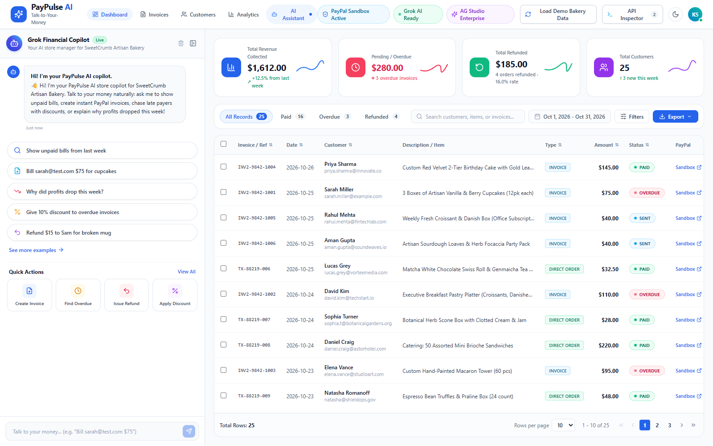
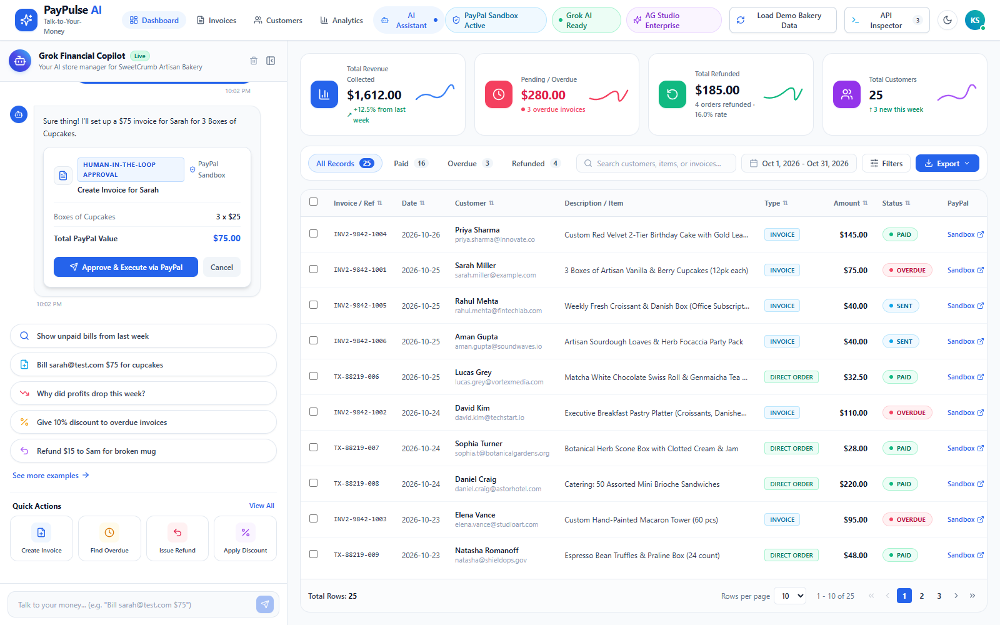

<div align="center">

# ⚡ PayPulse AI — The "Talk-to-Your-Money" Business Helper
### Conversational PayPal Store Manager & Zero-Dashboard Financial Workbench

> **Engineered for the "Build What's Next with PayPal and AI" Global Hackathon**  
> *Inspired by PayPal's Core Hackathon Theme: "Build a payments dashboard without building a dashboard."*

[](LICENSE)
[](https://nextjs.org)
[](https://www.typescriptlang.org)
[](https://developer.paypal.com)
[](https://groq.com)
[](https://www.ag-grid.com)
[](https://paypulse-ai-u8wk.onrender.com)
[](https://zapier.com)

[🚀 Live Demo](https://paypulse-ai-u8wk.onrender.com) • [✨ Key Features](#-key-features) • [📸 Visual Showcase](#-visual-showcase) • [🏗️ Architecture](#️-system-architecture--ascii-file-layout) • [⚡ Hackathon Sponsor Alignment](#-hackathon-sponsor-tool-stacking)

</div>

---

## 💡 Executive Summary

Small business owners (such as home bakeries, artisanal coffee roasters, freelance photographers, and boutique creators) waste hours navigating complex multi-nested financial accounting portals, manually drafting invoices, cross-referencing unpaid orders, and wrestling with CSV spreadsheets.

**PayPulse AI** replaces the cumbersome static dashboard with an intelligent, conversational store manager:
1. **Talk to Your Money:** Merchants speak or type natural business commands (*"Bill Sarah $75 for cupcakes"*, *"Who hasn't paid me this month?"*, *"Why did revenue drop this week?"*).
2. **Autonomous Execution with Human-in-the-Loop Safety:** The AI parses intent, calculates totals, generates formatted PayPal Sandbox drafts, and renders an interactive verification card before executing live PayPal API calls.
3. **Interactive AG Grid Financial Workbench:** Connected in real-time to the AI copilot. Every conversation dynamically highlights, filters, sorts, or appends rows to a high-performance data table.
4. **Collapsible Workspace:** Toggle between split-screen copilot mode and a full-width AG Grid enterprise table with a single click.

---

## 📸 Visual Showcase

<div align="center">

### 🌟 Main Operational Dashboard & AG Grid Workbench
*High-resolution overview with real-time KPI metrics, active filter chips, and AG Grid Quartz table*


### 💬 Conversational Copilot & Human-in-the-Loop Approval Card
*Natural language prompt triggers Groq/Grok AI to prepare an itemized PayPal invoice draft with interactive confirmation*


### 🌙 High-Contrast Dark Mode
*Sleek OLED dark mode tailored for late-night bakery closing and high-stress financial reviews*


</div>

---

## ✨ Key Features

- **🗣️ Natural Language PayPal Invoicing:** Type *"Bill sarah@test.com $75 for cupcakes"* to draft an itemized PayPal Invoicing v2 transaction in milliseconds.
- **🛡️ Human-in-the-Loop Approval Cards:** Every destructive or financial transaction (invoice dispatch, discount reminder, partial refund) presents a structured visual card requiring human merchant confirmation before API execution.
- **⚡ AG Grid High-Performance Workbench:**
  - Real-time column filtering, multi-sort, and quick-search.
  - Custom cell renderers for status pills (`PAID`, `OVERDUE`, `SENT`, `REFUNDED`).
  - Direct hyperlinks to live PayPal Sandbox transaction receipts and invoices.
  - 1-click CSV export and responsive pagination.
- **💸 Automated Overdue Recovery with Zapier:** One command (*"Send overdue reminders with 10% discount"*) identifies delinquent accounts, applies algorithmic discounts, dispatches PayPal reminders, and fires a webhook to Zapier for customer CRM sync.
- **🔍 Financial Diagnostics & Profit Analysis:** Ask *"Why did profits drop this week?"* to receive a thorough breakdown cross-referencing refund spikes and delayed vendor payouts.
- **🎲 Randomized Bakery Demo Generator:** Click *"Load Demo Bakery Data"* to instantly inject randomized, realistic orders for *"SweetCrumb Artisan Bakery"*.
- **🌓 Adaptive Theme Engine:** Seamless switching between crisp Light Mode and pure-black Dark Mode (`#090D16`).
- **🎛️ Collapsible AI Sidebar:** Slide the AI copilot open for conversational guidance, or collapse it to give the AG Grid data table 100% viewport width.

---

## ⚡ Hackathon Sponsor Tool Stacking

PayPulse AI was intentionally designed to leverage the hackathon's core and bonus sponsor ecosystems:

| Sponsor / Technology | Integration Details | Role in PayPulse AI |
|:---|:---|:---|
| **PayPal Sandbox REST APIs** | Invoicing v2 (`/v2/invoicing/invoices`), Orders v2, Payment Captures (`/v2/payments/captures/{id}/refund`), OAuth2 tokens | Powers all invoice drafting, direct billing, payment status verification, and instant refunds. |
| **Groq & xAI Grok** | Dual LLM integration supporting LLaMA 3.3 70B via ultra-low latency Groq API + Grok-4.7 | Natural language understanding, JSON tool-calling, intent extraction, and automated prompt synthesis. |
| **AG Grid Enterprise** | `ag-grid-react` v32 with Quartz styling, custom formatters, dynamic row-level triggers, and column resizing | High-throughput financial workbench replacing static tabular reports with interactive data exploration. |
| **Render Cloud** | Infrastructure as Code via `render.yaml` specification | Cloud deployment with automatic container builds and environment variable injections. |
| **Zapier Webhooks** | Outbound Webhook triggers on reminder batches and high-value orders | Connects PayPal invoice events to Slack, Discord, Google Sheets, or CRM systems. |
| **APIMatic Context** | OpenAPI 3.0 specification mapping for PayPal REST endpoints | Streamlines contract validation, schema typing, and SDK compatibility. |

---

## 🏗️ System Architecture & ASCII File Layout

```
paypulse-ai/
├── assets/
│   └── screenshots/
│       ├── hero-preview.png         # Main dashboard view
│       ├── feature-interaction.png  # Human-in-the-loop copilot approval
│       └── dark-mode-preview.png    # High-contrast OLED dark mode
├── scripts/
│   └── capture-screenshots.js       # Headless screenshot automation script
├── src/
│   ├── app/
│   │   ├── api/
│   │   │   ├── chat/route.ts        # AI Copilot engine (Groq & xAI Grok tool calling)
│   │   │   ├── paypal/route.ts      # PayPal Sandbox REST integration (OAuth2, Invoices, Refunds)
│   │   │   ├── store/seed/route.ts  # Demo data seed endpoints
│   │   │   └── zapier-notify/       # Outbound Zapier webhook dispatcher
│   │   ├── favicon.ico
│   │   ├── globals.css              # Custom styling, quartz themes & scrollbars
│   │   ├── layout.tsx               # Root layout & StoreProvider wrapper
│   │   └── page.tsx                 # Main application dashboard
│   ├── components/
│   │   ├── ApiInspector.tsx         # Real-time network telemetry & JSON inspector drawer
│   │   ├── ChatDrawer.tsx           # Collapsible AI copilot panel with quick prompts
│   │   ├── Header.tsx               # Nav tabs, theme toggle, demo seed button & status pills
│   │   ├── KpiCards.tsx             # Live revenue, overdue, refunded & customer metric cards
│   │   └── TransactionGrid.tsx      # High-performance AG Grid Quartz table
│   ├── context/
│   │   └── StoreContext.tsx         # Central state store (transactions, copilot history, API logs)
│   ├── lib/
│   │   ├── paypal.ts                # PayPal REST API client helper
│   │   └── seed-data.ts             # Dynamic bakery transaction generator
│   └── types/
│       └── index.ts                 # TypeScript interfaces for Invoices, Orders & AI Actions
├── .env.example                     # Clean environment variables template
├── .gitignore                       # Strict exclusion for secrets, databases & builds
├── DEVPOST_SUBMISSION_ANSWERS.md    # Pre-drafted Devpost submission responses & scripts
├── LICENSE                          # Permissive MIT Open Source License
├── package.json                     # Dependency manifests & scripts
├── render.yaml                      # Render Blueprint 1-click cloud configuration
├── tailwind.config.ts               # Tailwind CSS theme configuration
└── tsconfig.json                    # TypeScript compiler options
```

---

## 🚀 Quickstart & Local Setup

### Prerequisites
- Node.js 18.x or 20.x
- npm, pnpm, or yarn
- *(Optional)* Free PayPal Developer Sandbox account ([developer.paypal.com](https://developer.paypal.com))
- *(Optional)* Free Groq API Key ([console.groq.com](https://console.groq.com)) or xAI Grok Key

### 1. Clone the Repository
```bash
git clone https://github.com/kshitijhurle95-prog/paypulse-ai.git
cd paypulse-ai
```

### 2. Install Dependencies
```bash
npm install
```

### 3. Configure Environment Variables
Copy `.env.example` to `.env.local`:
```bash
cp .env.example .env.local
```

Edit `.env.local` with your developer keys:
```env
# AI API Key (Groq or xAI Grok)
GROQ_API_KEY=gsk_your_groq_api_key_here
# OR:
# XAI_API_KEY=xai_your_xai_key_here

# PayPal Sandbox Developer Credentials
PAYPAL_CLIENT_ID=your_paypal_sandbox_client_id_here
PAYPAL_CLIENT_SECRET=your_paypal_sandbox_client_secret_here
PAYPAL_ENVIRONMENT=SANDBOX

# AG Grid License (Optional evaluation key included)
NEXT_PUBLIC_AG_GRID_LICENSE_KEY=your_key_here

# Optional Zapier Webhook
ZAPIER_WEBHOOK_URL=https://hooks.zapier.com/hooks/catch/xxxxxx/yyyyyy/
```

> **Note for Hackathon Judges:** If you test without providing API keys, PayPulse AI's **Crash-Proof Sandbox Engine** automatically kicks in. It returns realistic mock PayPal sandbox payloads (`INV2-XXXX-XXXX`), updates the table, and allows testing every scenario with zero friction!

### 4. Run the Development Server
```bash
npm run dev
```

Open [http://localhost:3000](http://localhost:3000) in your browser to experience PayPulse AI.

---

## 🧪 5 Instant Scenarios for Judges

| # | Business Scenario | Quick Prompt to Click or Type | Expected AI & AG Grid Action |
|:---:|:---|:---|:---|
| **1** | **Smart Table Filtering** | *"Show unpaid bills from last week"* | Filters AG Grid to overdue/pending rows, sorts by date, and highlights customer names in chat. |
| **2** | **Natural Language Billing** | *"Bill sarah@test.com $75 for cupcakes"* | Generates a Human-in-the-Loop Approval Card; on clicking `Approve`, calls PayPal Sandbox Invoicing API and adds a `SENT` row to the grid. |
| **3** | **Discounted Late Reminders** | *"Who is overdue? Send payment reminder with a 10% discount"* | Filters table to overdue records, applies a 10% discount, dispatches PayPal reminder notification, and fires Zapier webhook. |
| **4** | **Financial Diagnosis** | *"Why did profits drop this week?"* | Diagnoses net balance fluctuations by correlating 4 refunded orders and late payments, explaining the exact bottleneck. |
| **5** | **Instant Partial Refund** | *"Refund $15 to Natasha for damaged pastry box"* | Finds Natasha's transaction row, highlights it in AG Grid, renders refund verification card, and issues PayPal refund. |

---

## 🔒 Security & Privacy

- **Zero Secret Leakage:** `.env` and `.env*.local` are explicitly excluded in `.gitignore`. No private API keys or merchant credentials are ever exposed in public client bundles or version control.
- **Human Confirmation Protocol:** Sensitive financial actions (invoicing, refunds, bulk notifications) cannot execute without an explicit merchant approval click.
- **Sandbox Isolation:** Default environment points exclusively to PayPal Sandbox endpoints (`https://api-m.sandbox.paypal.com`), ensuring absolute safety during evaluation.

---

## 📜 License

This project is licensed under the **MIT License** — see the [LICENSE](LICENSE) file for details. Built openly for the global developer and small business community.
