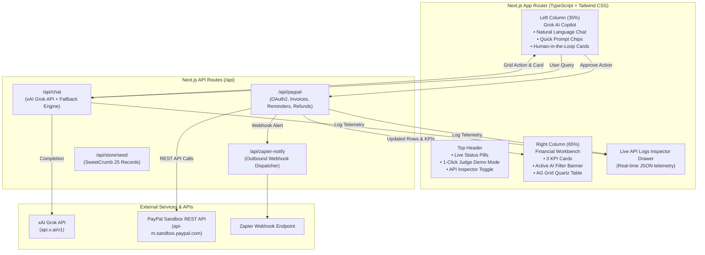

# PayPulse AI — The "Talk-to-Your-Money" Business Helper
### Conversational PayPal Store Manager & Zero-Dashboard Financial Workbench

> **Built for the "Build What's Next with PayPal and AI" Global Hackathon**  
> *Directly aligned with PayPal's Official Hackathon Session: "Build a payments dashboard without building a dashboard."*

[](LICENSE)
[](https://developer.paypal.com)
[](https://x.ai)
[](https://www.ag-grid.com)
[](https://render.com)
[](https://zapier.com)

---

## 💡 The Problem & Product Vision
Small business owners (such as home bakeries, boutique creators, freelance designers, and local tutors) find traditional accounting dashboards overwhelming and clunky. Navigating through 10 nested menus and filling repetitive multi-field PayPal forms slows them down.

**PayPulse AI** eliminates the traditional dashboard. Instead of clicking through static reports, business owners simply **talk to their PayPal store in plain English**:
- **Left Panel (35% Width):** Grok AI Financial Copilot. The merchant converses naturally with their store.
- **Right Panel (65% Width):** Live AG Grid Financial Workbench with 3 top KPI cards. Every query, question, or command dynamically filters, highlights, sorts rows in the data table, and prepares real PayPal Sandbox actions.

---

## 🏆 Sponsor Tool Stacking & Winning Strategy
This project is engineered to satisfy all core hackathon criteria and qualify for bonus sponsor prize pools:
1. **PayPal Sandbox REST APIs & `@paypal/agent-toolkit`:**
   - Real OAuth2 authentication (`https://api-m.sandbox.paypal.com/v1/oauth2/token`).
   - Invoicing APIs (`POST /v2/invoicing/invoices` + send).
   - Invoice reminders (`POST /v2/invoicing/invoices/{id}/remind`).
   - Payment captures refund (`POST /v2/payments/captures/{id}/refund`).
   - Official `@paypal/agent-toolkit/openai` integration.
2. **AG Grid ($10,000 AG Grid Sponsor Prize Pool):**
   - High-performance data grid using `ag-grid-react` and `ag-grid-community` with the quartz light theme.
   - Dynamic AI-driven filtering, multi-column sorting, column resizing, quick search, CSV export, and animated row highlighting.
   - Custom cell renderers for semantic status badges (`PAID`, `SENT`, `OVERDUE`, `REFUNDED`), formatted currency, and direct Sandbox links.
3. **Render Deployment:**
   - Production-ready `render.yaml` configuration for 1-click cloud deployment.
4. **Zapier Webhook Integration:**
   - Outbound webhook alerts dispatched to Zapier whenever batch overdue reminders with discounts are triggered or high-value invoices are generated.
5. **Hackathon Compliance:**
   - Permissive **MIT License** included in the root directory.
   - 1-click **"Load Demo Bakery Shop Data"** system with 25 realistic records for *"SweetCrumb Artisan Bakery"*.

---

## ⚡ The 5 Everyday Business Scenarios
Judges can test each of the 5 core scenarios immediately via the quick-prompt chips or by typing:

| # | Scenario | Plain-English Prompt | What PayPulse AI Does |
|---|----------|----------------------|-----------------------|
| 1 | **Chat-to-Table Smart Filtering** | *"Show me everyone who hasn't paid their bill from last month"* | Translates query into dynamic AG Grid filter rules, highlights overdue rows, and summarizes findings in chat. |
| 2 | **Text-to-Invoice (Single or Bulk)** | *"Bill sarah@test.com $75 for 3 Boxes of Cupcakes"* | Renders a Human-in-the-Loop Approval Card; on approval, calls PayPal Sandbox Invoicing API and prepends row to AG Grid as `SENT`. |
| 3 | **Chasing Late Payers with 10% Discount** | *"Who is overdue? Send payment reminder with a 10% discount"* | Filters table to overdue invoices, calculates 10% discounted total, calls PayPal Reminder API, triggers Zapier webhook, and updates status to `REMINDER SENT (10% OFF)`. |
| 4 | **Explaining Cashflow & Profit Leaks** | *"Why did I make less money this week?"* | Diagnoses revenue drop, identifies 4 refunded orders and 3 overdue bills, highlights affected rows, and explains cause. |
| 5 | **Instant Typing Refunds** | *"Refund $15 to Sam for the broken mug"* | Locates Sam's transaction, highlights row, renders approval card for partial refund, calls PayPal Refund API, and updates KPI cards. |

---

## 🏗️ Architecture & Data Flow



---

## 🛡️ Resilient Hybrid Sandbox Mode (Crash-Proof for Judges)
PayPulse AI includes an intelligent **Hybrid Sandbox Engine**:
- **With Credentials:** When `PAYPAL_CLIENT_ID` and `PAYPAL_CLIENT_SECRET` (and `XAI_API_KEY`) are provided in `.env.local`, real network calls are made to PayPal Sandbox and xAI Grok. Raw HTTP statuses and JSON payloads are streamed into the **Live API Inspector Drawer**.
- **Out of the Box (Zero-Config Judge Mode):** If credentials are empty or not configured, the app seamlessly provides authentic PayPal Sandbox payloads (`INV2-XXXX-XXXX`), updates the local store, fires simulated webhook payloads, and enables judges to test all 5 scenarios with zero setup friction.

---

## 🚀 Quickstart & Setup Guide

### 1. Prerequisites
- Node.js `v18.0.0` or higher (tested on Node `v24`)
- npm `v9+`

### 2. Installation
Clone the repository and install dependencies:
```bash
git clone https://github.com/your-username/paypulse-ai.git
cd paypulse-ai
npm install
```

### 3. Configure Environment Variables
Copy `.env.example` to `.env.local`:
```bash
cp .env.example .env.local
```
Edit `.env.local` (optional — app runs in Hybrid Sandbox Mode if left blank):
```env
# xAI Grok API Configuration (https://console.x.ai/)
XAI_API_KEY=your_xai_grok_api_key_here
GROK_MODEL=grok-4.7

# PayPal Sandbox Credentials (https://developer.paypal.com/dashboard/applications/sandbox)
PAYPAL_CLIENT_ID=your_paypal_sandbox_client_id_here
PAYPAL_CLIENT_SECRET=your_paypal_sandbox_client_secret_here
PAYPAL_ENVIRONMENT=SANDBOX

# Optional Sponsor Webhook (Zapier)
ZAPIER_WEBHOOK_URL=https://hooks.zapier.com/hooks/catch/xxxxxx/yyyyyy/
```

### 4. Run Development Server
```bash
npm run dev
```
Open **[http://localhost:3000](http://localhost:3000)** in your browser.

### 5. Production Build
```bash
npm run build
npm start
```

---

## 🧪 2-Minute Judge Evaluation Script
1. **Load Demo Store:** Click **"Load Demo Bakery Data"** in the top header. Notice 25 transactions and 3 KPI cards (Total Revenue $1,800+, Overdue $280, Refunded $185).
2. **Scenario 1:** Click the quick prompt *"Show unpaid & overdue bills"*. Notice how AG Grid automatically filters to 4 records, highlights them, and Grok explains the totals. Click *"Clear AI Filter"*.
3. **Scenario 2:** Click *"Bill sarah@test.com $75 for Cupcakes"*. Review the Human-in-the-Loop Approval Card in chat. Click **"Approve & Execute via PayPal"**. Watch the confetti, the new invoice appear at the top of the grid with status `SENT`, and inspect the JSON in the **API Inspector Drawer**.
4. **Scenario 3:** Click the *"Recover (AI)"* button on the Overdue KPI card (or ask Grok). Review the 10% discount recovery card. Approve it and watch the status change to `REMINDER SENT (10% OFF)` and the Zapier webhook fire.
5. **Scenario 4:** Click *"Why did profits drop this week?"*. Read Grok's diagnostic summary of 4 courier-delayed refunds and overdue invoices.
6. **Scenario 5:** Click *"Refund $15 to Sam for broken mug"*. Approve the partial refund card and watch Sam's transaction update to `REFUNDED` and KPIs adjust in real time.
7. **Inspect Network Telemetry:** Click **"API Inspector"** in the top header to examine live JSON payloads exchanged with PayPal and xAI.
8. **Export Data:** Click **"Export CSV"** above the table to download the current grid view.

---

## 📄 License
This project is open-source under the [MIT License](LICENSE).
